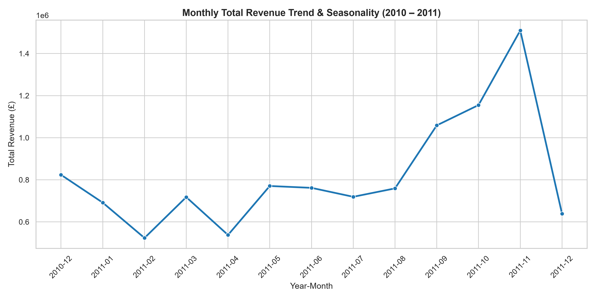
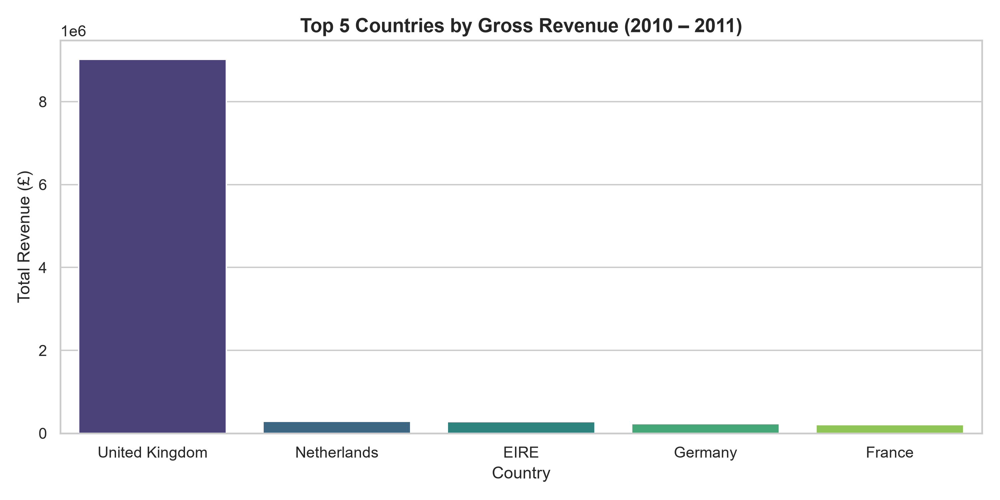
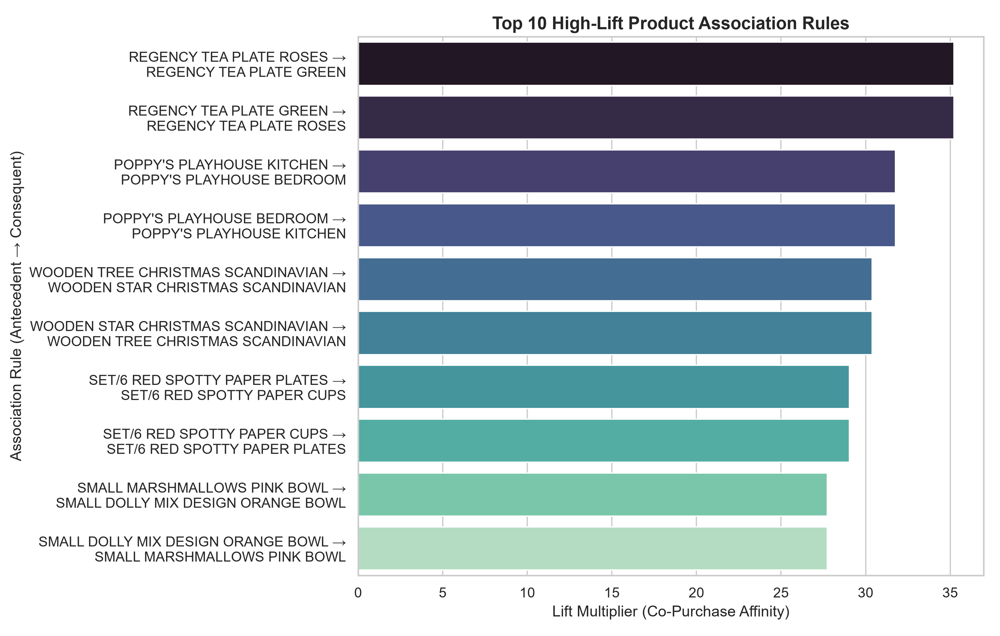
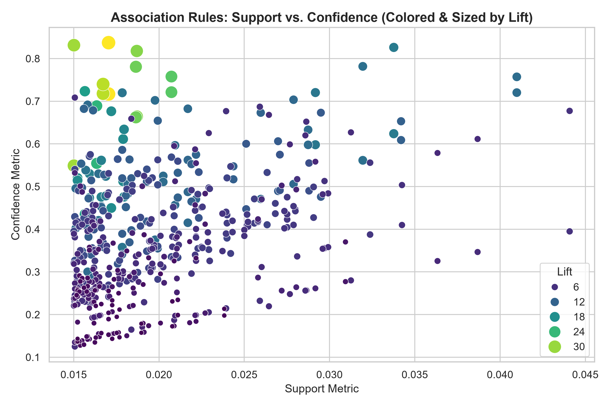

# 🛒 Retail Demand & Market Basket Analytics Pipeline

[](https://www.python.org/)
[](https://jupyter.org/)
[](https://pandas.pydata.org/)
[](https://seaborn.pydata.org/)
[](LICENSE)
[]()

> **Arrowstack Data Science 1-Month Internship — Project 2**  
> **Author:** Emmanuel Bright Chetachi | **App / Roll ID:** `AS-2026-18951`  
> **Email:** `emmanuelchetachibright@gmail.com`

---

## 📌 Executive Summary & Problem Framing

In retail and e-commerce operations, optimizing product placement, inventory allocation, and promotional cross-selling requires deep visibility into consumer purchasing patterns. Understanding transaction dynamics across product categories, peak demand seasons, and co-purchasing affinity enables organizations to maximize basket size, prevent costly out-of-stock events, and streamline supply chain logistics.

This project delivers an end-to-end data science pipeline and association rule mining study analyzing **541,909 historical retail transaction logs** from a multinational retail enterprise. By pairing rigorous data quality auditing with seasonal demand decomposition and high-dimensional market basket analysis, this investigation delivers concrete, evidence-based recommendations for commercial stakeholders.

* **Primary Stakeholder:** Retail Category Managers, Inventory Planning Directors, E-Commerce Merchandising & Recommendation Leads.
* **Core Business Decisions Enabled:**
  1. Designing dynamic e-commerce recommendation bundles (*"Frequently Bought Together"*).
  2. Synchronizing warehouse and physical shelf replenishment for highly complementary goods.
  3. Pre-allocating inventory buffers and logistics capacity for seasonal Q4 demand spikes.

---

## 🚀 Key Findings & Quantitative Business Metrics

| Analysis Dimension | Statistical Observation | Business Impact & Operational Takeaway |
| :--- | :--- | :--- |
| **Gross Analyzed Volume** | **530,104 valid transactions** generating **£10,666,684.54** in revenue | Broad, high-throughput retail dataset representing international consumer and wholesale orders. |
| **Geographic Revenue Dominance** | **United Kingdom:** **£9.03M (84.66%)**<br>**Netherlands:** **£285.4K (2.68%)**<br>**EIRE:** **£263.3K (2.47%)**<br>**Germany:** **£228.9K (2.15%)**<br>**France:** **£209.7K (1.97%)** | The domestic UK market provides the overwhelming core revenue foundation, while Western European markets represent high-yield cross-border expansion targets. |
| **Demand Seasonality & Surge** | **November 2011 Peak:** **£1.51M**<br>(~4x January baseline of £407K) | Distinct Q4 pre-holiday surge starting in September and culminating in November. Demands advanced procurement 60–90 days ahead. |
| **Top Product by Volume** | **Paper Craft Little Birdie:** **80,995 units**<br>**Medium Ceramic Storage Jar:** **77,916 units** | Bulk novelty, decorative, and gift items lead unit velocity, functioning as high-turnover traffic drivers. |
| **Association Rule Mining** | **542 statistically valid rules** identified at $\text{Support} \ge 1.5\%$ | High-affinity product pairs exhibit lift values exceeding **30x**, confirming powerful co-purchasing linkages rather than independent random demand. |

---

## 📊 Visual Analytics & Exploratory Insights

### 1. Monthly Revenue Trend & Seasonality

* **Finding:** Sales revenue shows steady baseline activity through Q1–Q2 (~£400K–£650K/month), followed by accelerated growth entering Q3 and an exponential surge in Q4. November 2011 achieved peak monthly gross sales of **£1,509,496.33**, demonstrating the extreme sensitivity of retail operations to holiday purchasing cycles.
* **Operational Action:** Inventory planning must front-load supply orders in August/September to avert fulfillment backlogs during the November peak.

### 2. Geographic Market Concentration

* **Finding:** The United Kingdom accounts for **£9,025,222.08** (84.66%) of all gross turnover. Netherlands (£285,446.12) and EIRE (£263,276.82) represent the strongest non-UK revenue drivers despite significantly smaller population footprints.
* **Operational Action:** Optimize local distribution hubs in Western Europe to reduce international shipping friction and expand high-margin wholesale accounts.

### 3. Top High-Lift Product Association Rules

* **Finding:** Top product pairings exhibit extraordinary co-purchase affinity. When customers purchase *Regency Tea Plate Roses*, the probability of simultaneously purchasing *Regency Tea Plate Green* increases by **35.21x** over baseline randomness (71.7% confidence). Similarly, nursery toys and decorative party items exhibit co-purchase lifts between **27x and 32x**.
* **Operational Action:** Create digital bundle discounts and physical endcap co-locations for identified pairings.

### 4. Association Rules: Support vs. Confidence Landscape

* **Finding:** The scatter distribution highlights the trade-off between rule support and confidence, colored and sized by lift multiplier. High-lift rules cluster in the 60%–85% confidence range with focused transaction support (1.5%–2.5%), highlighting specific, highly correlated sub-catalog niches ideal for algorithmic upselling.

---

## 🧺 Market Basket Analysis (Association Rule Mining)

Using a binary transaction-item matrix built across the catalog's top 500 velocity items ($\text{Support threshold} \ge 1.5\%$), association rule mining extracted **542 statistically significant rules**. Top high-lift associations include:

| Antecedent (Item A) | Consequent (Item B) | Support (%) | Confidence (%) | Lift Multiplier | Strategic Application |
| :--- | :--- | :---: | :---: | :---: | :--- |
| **REGENCY TEA PLATE ROSES** | **REGENCY TEA PLATE GREEN** | **1.70%** | **71.69%** | **35.21x** | Coordinated Dining Set Cross-Sell |
| **POPPY'S PLAYHOUSE KITCHEN** | **POPPY'S PLAYHOUSE BEDROOM** | **1.67%** | **71.79%** | **31.76x** | Toy Suite Bundling Promotion |
| **WOODEN TREE CHRISTMAS** | **WOODEN STAR CHRISTMAS** | **1.50%** | **83.14%** | **30.39x** | Seasonal Holiday Décor Pairing |
| **SET/6 RED SPOTTY PAPER PLATES** | **SET/6 RED SPOTTY PAPER CUPS** | **1.87%** | **66.41%** | **29.04x** | Party Supplies One-Click Add-on |
| **SMALL MARSHMALLOWS PINK BOWL** | **SMALL DOLLY MIX ORANGE BOWL** | **1.86%** | **78.08%** | **27.73x** | Confectionery Storage Dual-Pack |

---

## 🧹 Data Quality Audit & Cleaning Protocol

A rigorous data hygiene audit was conducted across the raw transaction dataset:

1. **Volume & Integrity Audit:**
   - **Total Raw Records:** 541,909 transactions across 8 attributes (`InvoiceNo`, `StockCode`, `Description`, `Quantity`, `InvoiceDate`, `UnitPrice`, `CustomerID`, `Country`).
   - **Missing Descriptions:** 1,454 records (0.27%) lacked product descriptions.
   - **Missing Customer IDs:** 135,080 records (24.93%) lacked registered user IDs (guest / walk-in purchases). Preserved for item-level basket analysis to avoid biasing transactional demand.
   - **Duplicate Detection:** 5,268 duplicate transaction rows detected and reviewed.

2. **Cancellations & Return Anomaly Handling:**
   - **Cancellations Identified:** 9,288 invoice records featured invoice identifiers prefixed with `'C'` or had negative `Quantity` values reflecting product returns/reversals.
   - **Action Taken:** Filtered out of demand estimation to reflect true gross sales velocity.

3. **Pricing Hygiene & Normalization:**
   - Transactions with `UnitPrice <= 0` (sample/accounting write-offs) were eliminated.
   - Engineered features: Line `Revenue = Quantity * UnitPrice`, normalized `InvoiceDate` to standard timestamp, and extracted monthly accounting periods (`YearMonth`).
   - **Cleaned Dataset Output:** **530,104 valid transactions** totaling **£10,666,684.54** in gross sales exported to `Cleaned_online_retail.csv`.

---

## 💡 Strategic Recommendations for Stakeholders

1. **Algorithmic Cross-Selling & E-Commerce Bundling:**
   - Implement real-time basket prompts at checkout: *"Customers who purchased [Regency Tea Plate Roses] also added [Regency Tea Plate Green]"*. With confidence exceeding 71% and lift > 35x, automated prompts will directly elevate Average Order Value (AOV).
2. **Synchronized Inventory Stocking:**
   - Prevent "orphan out-of-stock" scenarios where complementary goods cannot be fulfilled together. Pair inventory reorder triggers for items with lift > 25x so purchase orders for Item A automatically audit Item B stock levels.
3. **Q4 Supply Chain & Warehouse Pre-Allocation:**
   - Scale logistics capacity, warehouse staffing, and freight contracts 60–90 days ahead of the October–November volume ramp, where sales velocity spikes by 3.7x relative to Q1.
4. **B2B International Account Management:**
   - Allocate dedicated B2B account support for wholesale buyers in the Netherlands, EIRE, Germany, and France, who drive substantial average basket sizes with low churn risk.

---

## 📁 Repository Structure

```
arrowstack-retail-basket-analytics/
├── Emmanuel_Bright_Chetachi_Retail_Demand_&_Basket_Analysis.ipynb  # Interactive Jupyter/Colab Notebook
├── retail_demand_basket_pipeline.py                                # Modular, end-to-end Python pipeline
├── Online_Retail.csv                                               # Raw retail transaction dataset (541K records)
├── output/
│   ├── figures/
│   │   ├── monthly_revenue_trend.png                               # Monthly revenue seasonality chart
│   │   ├── top_countries_by_revenue.png                            # Geographic revenue barplot
│   │   ├── top_10_high_lift_rules.png                              # Top 10 high-lift association rules plot
│   │   └── basket_rules_scatter.png                                # Support vs Confidence scatterplot
│   └── retail_association_rules.csv                                # Extracted association rules dataset
├── requirements.txt                                                # Project environment dependencies
├── .gitignore                                                      # Git ignore rules
├── LICENSE                                                         # MIT License
└── README.md                                                       # Professional portfolio documentation
```

---

## 🛠️ Tech Stack & Dependencies

* **Language:** Python 3.8+
* **Data Processing & Analytics:** `pandas`, `numpy`
* **Data Visualization:** `matplotlib`, `seaborn`
* **Workflow Environments:** Google Colab, Jupyter Notebook, Visual Studio Code
* **Version Control:** Git, GitHub

---

## 💻 How to Run the Project Locally

### 1. Clone the Repository
```bash
git clone https://github.com/Ecoplex82/arrowstack-retail-basket-analytics.git
cd arrowstack-retail-basket-analytics
```

### 2. Set Up a Virtual Environment & Install Dependencies
```bash
# Create virtual environment
python -m venv venv

# Activate virtual environment (Windows)
.\venv\Scripts\activate
# Activate virtual environment (macOS/Linux)
source venv/bin/activate

# Install requirements
pip install -r requirements.txt
```

### 3. Run the Automated Pipeline via CLI
Execute the complete end-to-end audit, cleaning, metrics calculation, rule mining, and figure generation:
```bash
python retail_demand_basket_pipeline.py
```

### 4. Run the Interactive Jupyter Notebook
```bash
jupyter notebook Emmanuel_Bright_Chetachi_Retail_Demand_&_Basket_Analysis.ipynb
```

---

## 🔮 Production Readiness, Limitations & Future Roadmap

* **Data Limitations:**
  - The dataset represents transactional logs without user clickstream data, ad campaign attribution, or post-purchase customer reviews.
  - Guest transactions (~25% missing CustomerID) prevent full multi-year customer cohort tracking.
* **Production Roadmap:**
  1. **Sub-Item Recommendation Engine:** Integrate collaborative filtering (e.g., Matrix Factorization / Alternating Least Squares) to complement association rules for long-tail items.
  2. **Customer RFM Segmentation:** Segment accounts by Recency, Frequency, and Monetary value to tailor promotional discounts.
  3. **Real-Time API Deployment:** Package the basket rule scoring logic into a lightweight FastAPI service for real-time checkout recommendation calls.

---

## 📜 License & Acknowledgments

This project is licensed under the [MIT License](LICENSE).  
Developed as part of the **Arrowstack Data Science 1-Month Internship Program** (Project 2: Retail Demand & Basket Analysis).